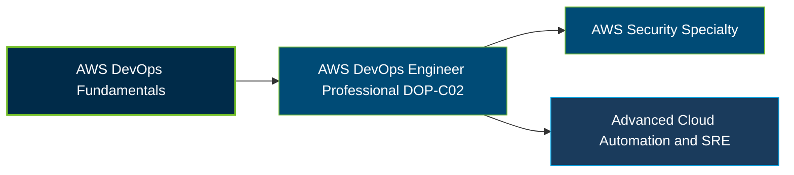

# AWS Certified DevOps Engineer - Professional (DOP-C02) Certification Exam Guide

A dedicated, comprehensive study guide and cloud automation reference repository for candidates preparing for the **AWS Certified DevOps Engineer - Professional (DOP-C02) Certification Exam**.

---

## Exam Overview

The AWS Certified DevOps Engineer - Professional certification validates advanced skills in provisioning, operating, automating, and managing distributed applications and infrastructure on AWS.

- **Exam Format**: Multiple-choice and multiple-response questions; testing center or online proctored exam
- **Target Audience**: DevOps engineers, cloud operations engineers, site reliability engineers, and experienced AWS professionals
- **Prerequisites**: No formal prerequisite; AWS recommends two or more years of experience provisioning, operating, and managing AWS environments

---

## Core Exam Domains & Knowledge Areas

### 1. SDLC Automation

- Implementing and managing continuous integration and continuous delivery pipelines.
- Automating application build, test, and deployment processes.
- Managing release strategies, deployment workflows, and rollback procedures.

### 2. Configuration Management and IaC

- Provisioning and managing infrastructure using infrastructure as code.
- Automating configuration management and resource deployment.
- Maintaining reusable, consistent, and version-controlled infrastructure definitions.

### 3. Resilient Cloud Solutions

- Designing highly available and scalable AWS solutions.
- Implementing automated recovery, replication, and failover processes.
- Meeting resilience requirements, including recovery time and recovery point objectives.

### 4. Monitoring and Logging

- Collecting, aggregating, and storing logs and metrics.
- Analyzing monitoring data to detect operational issues.
- Automating monitoring, alerting, and event management.

### 5. Incident and Event Response

- Detecting, investigating, and responding to operational incidents.
- Automating event-driven responses and remediation workflows.
- Analyzing failures and improving incident response procedures.

### 6. Security and Compliance

- Implementing identity and access management controls at scale.
- Automating security, governance, and compliance validation.
- Protecting infrastructure and application resources through security monitoring and policy enforcement.

---

## Certification Path

This is a suggested learning progression, not a mandatory certification sequence. AWS identifies Security Specialty as one possible next step; advanced SRE and automation study are professional development options rather than certifications.

---

## Recommended Practice & Study Resources

Combine official AWS exam preparation materials with hands-on automation, deployment, monitoring, and recovery exercises.

- **CertsGate**: Explore [DOP-C02 certification preparation resources](https://certsgate.com/exams/amazon/dop-c02) for supplementary study materials and practice questions.
- **Practical AWS Study**: Use the [AWS CloudFormation documentation](https://docs.aws.amazon.com/AWSCloudFormation/latest/UserGuide/Welcome.html) to practice infrastructure as code, repeatable deployments, and automated resource management.
